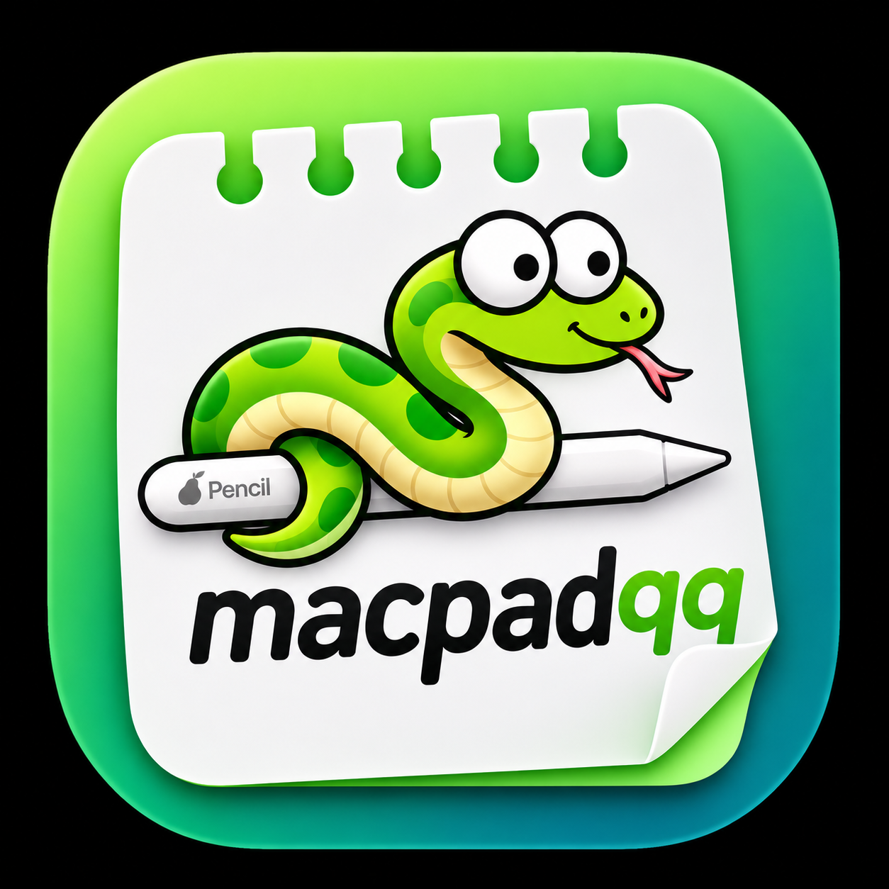
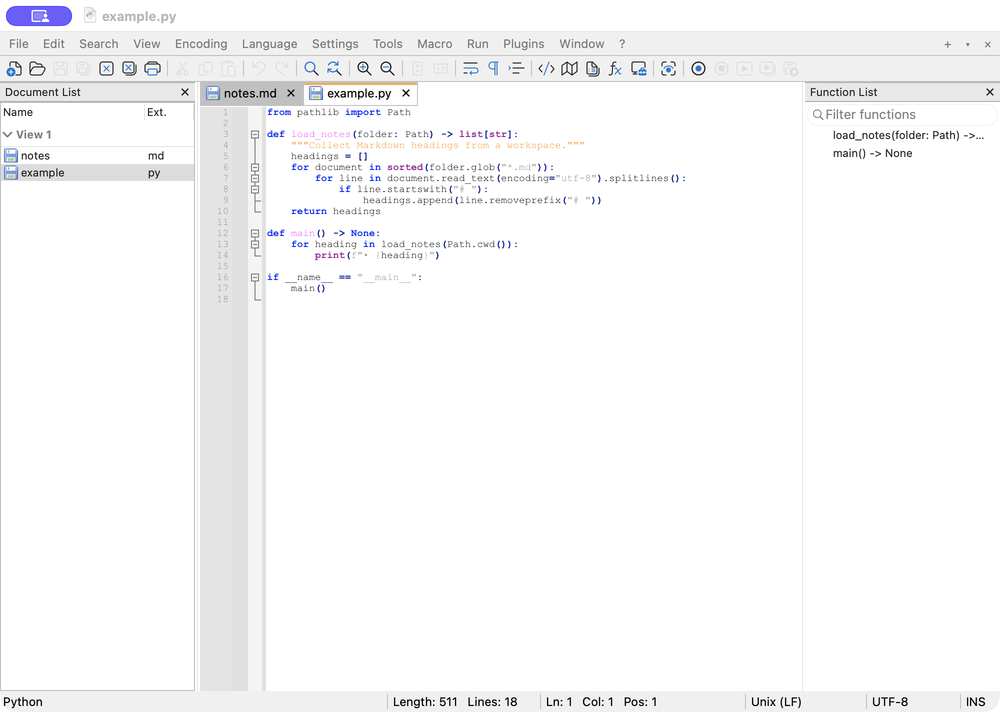

# macpadqq

[](docs/assets/macpadqq-logo.png)

macpadqq is a native macOS code and text editor. It is an independent fork of
Notepad++, originally created by Don Ho and developed by its contributors.
The macOS port uses AppKit for the interface, Scintilla Cocoa for editing,
and Lexilla for syntax highlighting. [Upstream project](https://github.com/notepad-plus-plus/notepad-plus-plus)



## Install on macOS

The current version is `0.2-beta`.

macpadqq runs natively on Apple silicon and Intel Macs with macOS 13 or later.
It reads existing XML themes, translations and user-defined languages.
Plugins use the [macOS plugin API](macos/MacpadPlugin.h). Windows DLLs need
to be ported and rebuilt to run inside macpadqq.

Check [GitHub Releases](https://github.com/vt244/macpad-QQ/releases)
for a build for your Mac. Choose `macpadqq-macOS-arm64.zip` for Apple silicon
or `macpadqq-macOS.zip` if a universal build is available. Download the matching
`SHA256SUMS`, verify the archive, then unpack it and move `macpadqq.app` to Applications.

```sh
shasum -a 256 macpadqq-macOS-arm64.zip
```

For a universal build, substitute `macpadqq-macOS.zip` in the command.
Compare the output with the matching entry in `SHA256SUMS`.

## Build from source

To build from source, install the Apple Command Line Tools and CMake 3.20 or
later, then run these commands from the repository root.

```sh
macos/build-app.sh
open 'dist/macpadqq.app'
```

Local and CI builds use ad hoc signing. The macOS workflow tests the native
app and bundles it with matching source and SHA-256 checksums.
[Build and release instructions](BUILD.md) · [macOS workflow](.github/workflows/macos.yml)

## What you can do

- Edit in two tabbed views, move tabs by dragging, and rotate the split from the divider's context menu. Use **View → Move/Clone Current Document** to open a second view.
- Use **Window → Manage Open Tabs** to sort tabs by name, path or modification date, apply the order, and save or close a selection.
- Move, resize or float panels such as **Document List**, **Folder as Workspace**, **Project Panels**, **Function List** and **Document Map**.
- Find, replace, count and mark matches using literal, extended or regular expression search. Search within a selection, across open documents, in folders or in projects.
- Under **Settings → Preferences → Searching**, set the character thresholds for automatic search within a selection and for filling the Find field. A selection threshold of 0 keeps **In selection** manual. You can also use a monospaced font for search fields.
- Refine previous searches from the results panel and navigate between hits with **Search → Next Search Result** and **Previous Search Result**.
- Use the **Edit** menu for column insertion, multiple selections, commenting, line sorting and autocompletion. **Clipboard History** keeps recent text entries in memory while its panel is open.
- Open, save and convert UTF‑8, UTF‑16 and legacy text. Automatic detection of legacy encodings is available under **Files and Tabs** in Preferences.
- Press **Space** on a file in **Folder as Workspace** or a **Project Panel** for a read-only text preview with line numbers. This also works for files with an unrecognized extension or no extension. Syntax highlighting uses the [bundled language definitions](PowerEditor/src/langs.model.xml), the current theme and imported user-defined languages. CSV previews show the original text.
- Set or clear read-only mode for all open documents from **Edit**. **Save All** asks for confirmation by default. Change that setting under **Settings → Preferences → Files and Tabs**.
- Reopen legacy text with its original encoding from **Encoding → Character Set**.
- Follow log files with **View → Monitoring (tail -f)**. Configure detection of external changes in **Settings → Preferences**.
- Record and replay editing, search and replace actions from the **Macro** menu. **Settings → Import Shortcuts and Run Commands…** reads compatible shortcuts, macros and commands from `shortcuts.xml`. Use **Shortcut Mapper** to assign shortcuts to menu actions or manage several bindings for one Scintilla command.
- Set print colors, line numbers, margins and header or footer text under **Settings → Preferences → Printing**.
- Use **Print Layout** in Preferences for header and footer fonts and form-feed page breaks. **File → Print Now** uses the selected printer.
- Open **Language → Toggle User Language Panel** to edit, copy or remove definitions in a dockable panel.
- Generate checksums from **Tools**, run macOS commands and save or open XML sessions.
- Double-click the empty space to the right of the tabs to open a new document.
- Close the editor window with the red button and click the Dock icon to bring back the same tabs. The working session, including unsaved edits and drafts, is also restored on the next launch when session recovery is enabled.
- Import existing XML themes, translations and user-defined languages.

Open files from **File → Open** or from Finder with **Open With → macpadqq**.
You can also select one or more files in Finder and choose **Open in macpadqq**
from the context menu’s **Services** section. If the action is hidden, enable
it under **System Settings → Keyboard → Keyboard Shortcuts → Services**.
Use the executable directly to open a file from the terminal at a specific line and column.

```sh
'dist/macpadqq.app/Contents/MacOS/macpadqq' -n20 -c4 -lpython example.py
'dist/macpadqq.app/Contents/MacOS/macpadqq' -multiInst -r 'src/*.py'
```

[Compatibility and current limitations](SUPPORTED_SYSTEM.md)

## Customize macpadqq

New installations use `~/Library/Application Support/macpadqq/profile/`.
Upgrades continue to use the existing profile if no macpadqq profile exists.

| Resource | Where to install it | Where to use it |
| --- | --- | --- |
| XML theme | `themes/` | **View → Theme** selects a theme. **Settings → Style Configurator** edits colors and fonts. Enable individual attributes from the theme’s **Global override** style in **Preferences → Global style override**. |
| XML translation | `localization/` | **Settings → Interface Language**. **Import XML…** copies the file into the profile. The default option also reads `nativeLang.xml` at the profile root. |
| User Defined Language XML | `userDefineLangs/` or `userDefineLang.xml` | Create and edit definitions through the **Language** menu. The same menu imports, exports and applies UDL XML. |
| Function and completion rules | `functionList/` and `autoCompletion/` | Override the supplied XML rules for **Function List** and **Auto-Completion**. |
| Context menus | `contextMenu.xml` and `tabContextMenu.xml` | Edit the editor and tab menus from **Settings**. |
| Toolbar | `toolbarButtonsConf.xml` and `toolbarIcons/` | Set built-in button visibility and supply icon overrides. Relaunch to apply changes. |
| Windows project and session paths | `windowsPathMappings.plist` | Map drive letters and UNC shares to local directories. See [path mapping examples](SUPPORTED_SYSTEM.md#map-windows-paths). |
| macOS plugin | `plugins/*.dylib` | Install from a local file or the catalog in **Plugins → Plugins Admin…**, then restart. Disabled files remain in `plugins/Disabled/`. |

The native plugin API supports document access, selection and byte ranges,
editor events, AppKit panels and multiple menu commands.
[Native plugin API](macos/MacpadPlugin.h) · [Plugin build example](BUILD.md#native-plugins)

## License and contributions

The editor is distributed under the GNU General Public License version 3.
The fork preserves upstream copyright notices. Third-party components, themes
and artwork have their own attribution and distribution considerations.
[GPLv3](LICENSE) · [Third-party notices](THIRD_PARTY_NOTICES.md)

[Project repository](https://github.com/vt244/macpad-QQ) · [Contributing](CONTRIBUTING.md)
